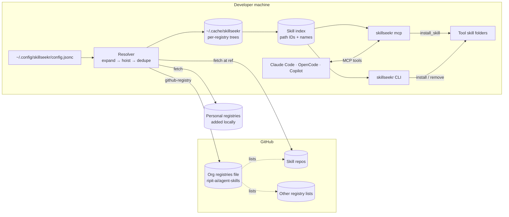
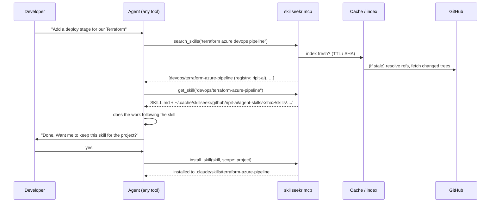

## Summary

**skillseekr** lets coding agents in **Claude Code**, **OpenCode**, and **GitHub Copilot** find and fetch [Agent Skills](https://agentskills.io) **on demand**, from any number of skill registries. People can do the same by hand with the `skillseekr` CLI.

The catalog is a **list of registries** rather than one repository. Each registry is a GitHub repo of skills, a single `SKILL.md` URL, or a **registries file** (another list of registries). The config format is the one used by [afriemann/skills-mcp](https://github.com/afriemann/skills-mcp), copied exactly, plus two new registry types for including registries files. `setup` points everyone at a default organizational registries file (for ripit-ai, `ripit-ai/agent-skills`), and each person can add more. Registries files are maintained however their owners want.

## Intent

The catalog will grow too large to install on every machine, and most skills only matter for certain kinds of work. Bulk-installing them bloats agent context and makes skills hard to keep current. Instead:

- **Agents serve themselves.** While working, an agent notices it could use a skill, searches the catalog, picks one, and uses it. Nobody has to know what exists ahead of time.
- **Skills arrive on demand.** Nothing is present until someone needs it, and nothing stays unless someone chooses to keep it.
- **Orgs share a list; individuals can extend it.** A registries file can give a whole team the same default catalog. People can add their own sources, and the tooling always shows which registry each skill came from.
- **Point to skills instead of copying them.** Registries stay where they live. A registries file lists them instead of pulling their content into a repo.

## Goals

1. A default organizational registries file (for ripit-ai, `ripit-ai/agent-skills`), written into everyone's config by `setup`, defines the default skill catalog.
2. Agents in Claude Code, OpenCode, and Copilot (CLI and VS Code) can search the catalog, fetch a skill, and optionally install it, with no human help.
3. People can search, inspect, install, update, and remove skills by hand with the `skillseekr` CLI.
4. Individuals can add their own registries in their local config.
5. Access is simple: anyone who can read a registries file, and the repos it lists, gets everything in it. There are no per-skill permissions.

## Non-goals

- **Permissions (RBAC).** Read access to a registries file, and to whatever repos it lists, is the only check.
- **A web UI or browsing site.** v1 is used only through the CLI and MCP.
- **A hosted service.** Everything runs locally. There's no central server and no usage telemetry in v1.
- **How registries files are maintained.** Review, pinning, CI, signing, and how skills get in are **up to whoever owns each registries file**. skillseekr only reads registries and serves their skills to the tools. It enforces no curation process. `skillseekr validate` and `skillseekr scan --gate` are there if owners want them in their own CI.
- **Copying skill content anywhere.** No import pipeline. Registries are read where they live.
- **Hosts other than GitHub.** Code repos are on GitHub, not Azure DevOps.
- **Extensions to the Agent Skills standard.** For example, no references from one skill to files outside its own folder.
- **Semantic or embedding search in v1.** See [[#Left to the builder]].
- **[[Agent Platform]] integration in v1.** It could consume the same config later. v1 shouldn't block that, but doesn't build it.
- **Per-project skill manifests in v1.** This is parked; see [[#Parked: per-project manifest (.skillseekr.yml)]].

## Anti-goals

These would count as failure even if everything technically works:

- **A compromised update reaching a machine unchecked** *(Phase 2)*. A skill that turns malicious through an update, or that slipped past review, must be caught by the runtime scan before an agent can use it. Overrides never carry over to new content.
- **Hidden sources.** Every skill must show which registry, and which chain of registries files, it came from, in search results and listings. Every override (a later registry replacing an earlier skill) must be reported.
- **The bulk install coming back.** If skill folders slowly fill with everything agents ever touched, the design has failed.
- **A second login.** If using skillseekr needs credentials beyond what people already have (`gh` CLI login, or an existing token env var), something has gone wrong.

## Constraints

- **Skill format:** the open Agent Skills standard. Each skill is a self-contained folder with a `SKILL.md` that has `name` and `description` frontmatter. Skills from any source are used exactly as published, without conversion.
- **Config format:** the skills-mcp format, **used as-is**, plus the `github-registry` and `http-registry` types defined below. A config file that skills-mcp accepts must mean the same thing to skillseekr.
- **Repo host:** GitHub. Registries are GitHub repos or HTTP URLs, as in the skills-mcp format. The skillseekr repo itself is `ripit-ai/skillseekr`.
- **Runtime:** Node/TypeScript. All three tools already depend on Node, and it's installed via Volta in the sandbox.
- **Platforms:** macOS and Linux, including the Lima sandbox VM. Windows is nice to have.

## Approaches considered

There were three rounds of decisions.

**How agents and people reach the catalog**

| # | Approach | Trade-offs | Decision |
|---|---|---|---|
| 1 | **A local MCP server plus a `skillseekr` CLI**, in one package | Every agent gets the same structured tools without shell permission prompts. The cost is owning an MCP server. | **Chosen** |
| 2 | CLI plus a starter skill, no MCP | Simpler, but every search triggers a shell permission prompt and agents have to parse plain-text output | Rejected |
| 3 | Build on the skills.sh CLI | Built around bulk installs, which works against the on-demand goal | Rejected |

**Where skills come from**

| # | Approach | Trade-offs | Decision |
|---|---|---|---|
| A | Copy every skill into one private repo through reviewed import PRs | Strict central curation, but it means building an import pipeline, provenance files, and fork-or-freeze rules | Rejected |
| B | **A config listing registries, read in place** (skills-mcp format plus registry-of-registries) | Nothing gets copied, and it's easy to add sources. Trust comes from how each registries file is curated, plus labelling where every skill came from and the Phase 2 runtime scan. | **Chosen** |

**How it gets built**

| # | Approach | Trade-offs | Decision |
|---|---|---|---|
| i | Fork afriemann/skills-mcp | Fetch, auth, and cache already exist, but it's a tiny Python project that lists install/sync as non-goals, so we'd own a divergent fork | Rejected |
| ii | **Our own Node/TS package that reads the same config format exactly** | One codebase we control. We rewrite the modest fetch/auth/cache layer, borrowing skills-mcp's design. | **Chosen** |
| iii | Contribute upstream and build only the missing pieces | Least code, but two tools in two languages, and we'd depend on upstream accepting our PRs | Rejected |

Other decisions:
- **Fetching doesn't install.** Installing is a separate, deliberate step.
- **Skill IDs follow skills-mcp: the slash-separated path under `skills_dir`**, for example `engineering/testing/tdd-development`. Registries are hoisted into one flat list, and skills are deduped by path ID, with the last one winning. `get_skill` also accepts a bare `name` when it's unique, so skills that refer to each other by name still resolve.

## Architecture



## Configuration

### Local config

skillseekr reads `~/.config/skillseekr/config.jsonc` (JSONC, comments allowed). `skillseekr setup` writes it with a single entry pointing at the default organizational registries file (`setup --registry <owner>/<repo>` to choose another):

```jsonc
{
  "registries": {
    "ripit-ai": {
      "type": "github-registry",
      "owner": "ripit-ai",
      "repo": "agent-skills",
      "ref": "main",
      "description": "ripit-ai shared skills",
      "policy": true,
      "auth": { "type": "gh_cli" }
    }
    // Personal additions go below. Anything here is resolved after the entry above,
    // so it overrides its skills or registries with the same name.
  },
  "cache": {
    "enabled": true,
    "ttl_seconds": 3600,
    "dir": "~/.cache/skillseekr"
  }
}
```

### Registry types

**Copied exactly from skills-mcp:**

| Type | Fields | Meaning |
|---|---|---|
| `github` | `owner`, `repo`, `skills_dir` (`""` = repo root; skills may be nested at any depth under it), `ref` (branch, tag, or commit SHA), optional `description`, `auth` | A repo containing skills |
| `http` | `url` (direct link to a `SKILL.md`), `skill_name`, optional `description`, `auth` | A single skill |

**New in skillseekr:**

| Type | Fields | Meaning |
|---|---|---|
| `github-registry` | `owner`, `repo`, `ref`, optional `path` (default `registries.jsonc` at the repo root), optional `description`, `auth` | A JSONC file in a repo, in this same format, listing more registries |
| `http-registry` | `url` (direct link to the JSONC file), optional `description`, `auth` | The same, at a URL |

Both include types accept an optional **`policy: true`** *(my call)*, which only has an effect in the **local config**. It lets that registries file's root supply `allow` and `block` entries (Phase 2) that apply to everyone who includes it this way. `setup` sets it on the default organizational entry. `policy` in any included file is ignored, so a list can't grant itself that power.

**Auth types** are the skills-mcp ones:
- `github_token` with `env_var`: the *name* of the environment variable, never the token itself.
- `gh_cli`: uses `gh auth token`.
- `bearer` with `env_var`: for HTTP sources.
- Omitted means no authentication.

**Auth in included files is restricted** *(my call, for security)*. A registries file reached through a `*-registry` include may only use `gh_cli` or no auth. `github_token` and `bearer`, which name an environment variable, are allowed **only in the user's own local config**. Otherwise any included list, including a third-party one someone adds for themselves, could name a variable like `AWS_SECRET_ACCESS_KEY` and send its value to whatever URL it chooses. `gh_cli` credentials are only ever sent to GitHub hosts. An included entry that breaks this rule is skipped and reported. This doesn't affect AC-5, because skills-mcp has no includes.

**Cache:** branch and tag refs, and HTTP sources, are re-checked after `ttl_seconds`. A commit SHA ref never expires. Only the top-level local config's `cache` section is used. A `cache` section in an included registries file is ignored.

### Resolution: expand, hoist, dedupe

1. **Expand.** Walk the local config's `registries` **in the order they appear in the file**. When a `github-registry` or `http-registry` entry is reached, fetch its file and replace the entry with that file's `registries`, expanded the same way (depth-first). Includes can be nested to any depth up to **5** levels *(my call)*. Loops are detected, skipped, and reported.
2. **Hoist.** The result is **one flat ordered list** of `github` and `http` registries, keyed by registry name. Include entries themselves don't appear in the list.
3. **Dedupe registries.** If two registries share a name, **the last one wins** and earlier ones are dropped.
4. **Index skills.** Fetch each remaining registry at its ref and find skills under `skills_dir` at any depth. A folder is a skill if it contains a `SKILL.md`, and folders without one (such as category folders) are skipped, exactly as in skills-mcp. Each skill's **ID is its slash-separated path relative to `skills_dir`**, for example `engineering/testing/tdd-development`. For an `http` registry, the ID is its `skill_name`.
5. **Dedupe skills by ID.** If a later registry has a skill with the same ID as an earlier one, **the later one wins.** Skills with the same `name` at different paths (`engineering/tdd-development` and `business/tdd-development`) are different skills, and both are kept.

Every override (a registry or skill replaced by a later one) is recorded. `skillseekr list`, `skillseekr doctor`, the `list_registries` tool, and search results all show what was overridden and by which source.

Each resolved skill also records **where it came from**: its `registry`, and `via`, the chain of entries that led to it starting from the local config, for example `ripit-ai → data-team → data-skills`. A skill from a registry listed directly in the local config has a one-element `via`.

> [!note] Key order matters
> "Last wins" depends on the order entries appear in the file. JavaScript objects keep insertion order except for keys that look like integers, so the builder must either parse JSONC in a way that preserves order, or reject registry keys made only of digits.

### Skill identity

- **ID:** the slash-separated path relative to `skills_dir`, which is the skills-mcp convention. Search results return IDs, and `get_skill` takes them.
- **Finding a skill by bare name** *(adds to skills-mcp's behaviour without breaking it)*: skills refer to each other by bare name ("use the `tdd-development` skill"), and the standard requires the folder name to match the frontmatter `name`. So `get_skill` and `skillseekr show` / `install` also accept a bare name. If exactly one resolved skill has that `name`, it resolves to that skill. If several do, the caller gets the list of matching IDs to choose from, with nothing chosen for them. A full path ID always works exactly as it does in skills-mcp.
- **Layout:**

  ```
  skills/
  ├── my-skill/SKILL.md                              → my-skill
  ├── engineering/testing/tdd-development/SKILL.md   → engineering/testing/tdd-development
  └── business/brainstorming/SKILL.md                → business/brainstorming
  ```
- Each skill is a self-contained folder, as the standard requires. Nothing outside the folder is fetched or installed with it.
- Search results also carry `registry` and `via`, so people can tell same-named skills apart and see which one won.

## Registries files

A **registries file** is a JSONC file in the same format (`registries`, plus in Phase 2 optional `allow` and `block`), included from the local config or from another registries file with `github-registry` or `http-registry`. For ripit-ai, the default that `setup` writes points at `ripit-ai/agent-skills`, whose root `registries.jsonc` might look like this:

```jsonc
{
  "registries": {
    "ripit-ai": {
      "type": "github", "owner": "ripit-ai", "repo": "agent-skills",
      "skills_dir": "skills", "ref": "main",
      "auth": { "type": "gh_cli" }
    },
    "anthropics": {
      "type": "github", "owner": "anthropics", "repo": "skills",
      "skills_dir": "skills", "ref": "3f2a9c1e…"
    },
    "data-team": {
      "type": "github-registry", "owner": "ripit-ai", "repo": "data-skills",
      "ref": "main", "auth": { "type": "gh_cli" }
    }
  }
  // Phase 2: optional "allow" and "block" entries, honoured when the local config includes this file with "policy": true
}
```

**Any registries file can be maintained however its owners want:** who reviews changes, whether sources are pinned to SHAs, whether skills are signed, how often things are updated. skillseekr doesn't check or enforce any of it. It resolves whatever the file says, labels where each skill came from, and (in Phase 2) scans everything on the user's machine before use. Owners who want automated checks can run `skillseekr validate` (format and resolution) and `skillseekr scan --gate critical` (security) in their own CI.

## The local side

### Fetching and caching

- `github` registries: resolve `ref` to a commit SHA through the GitHub API, then download the repo tarball for that SHA once and unpack it to `~/.cache/skillseekr/github/<owner>/<repo>/<sha>/`. The tree is kept exactly as upstream has it. *(Tarball rather than file-by-file is my call: one request per registry per SHA.)*
- `http` registries: fetch the file and cache it with its ETag or a content hash.
- The **index** (ID, name, description, registry, include chain, path, content hash) is built from the cache and saved per resolved config state. It's rebuilt only when a registry's SHA or content changes.
- **Offline or failing sources:** use the last good cache and warn. Results note that the catalog may be stale. A source that has never been fetched is reported by `doctor` and skipped.
- Fetched content is **untrusted data**. Use path-traversal checks on every file path, and never run anything as part of fetching or indexing.

### Fetching vs installing

**Fetching** (the default for agents): `get_skill` returns the `SKILL.md` body, the skill's file list, and the **absolute path of the skill's folder in the cache**. Agents read the skill's other files (`references/`, `templates/`, scripts) through the **`read_skill_file`** MCP tool rather than from disk. Claude Code and Copilot ask permission before reading outside the project, and in the VS Code remote setup the cache path may not be reachable from where the agent runs. The cache path is still returned for running a skill's scripts in place. Nothing is written to any tool's skill folder.

**Installing**: this happens only when explicitly asked, either by an agent calling `install_skill` or a person running `skillseekr install`. Installing copies the skill's folder into a tool's skill folder as `<name>/`, using the skill's `name`, which is the last part of its ID. The tool then loads it natively from then on. Tools only load skills one level deep, so the category path isn't kept on install. If two different IDs would install under the same `name` in the same scope, the install **refuses** and names the skill already there. Renaming isn't possible, because the standard requires the folder name to match the frontmatter `name`.

| Scope | Where it goes | Who sees it |
|---|---|---|
| `project` (default) | `<project>/.claude/skills/<name>/` | Claude Code, OpenCode, and Copilot all read project-level `.claude/skills/`, and teammates get it once it's committed |
| `user` | Each enabled tool's personal folder: `~/.claude/skills/`, `~/.config/opencode/skills/`, `~/.copilot/skills/` | Only that user, in every project |

> [!warning] Verify the paths
> Tool skill folders change often. For example, Copilot CLI stopped reading `~/.claude/` for skills in v1.0.36. The builder must check every path against current docs and keep the mapping in one table in the code.

**Install marker:** every installed skill folder contains a `.skillseekr.json` with `{id, name, registry, via, ref, sha, contentHash, installedAt}`. `list`, `outdated`, `update`, and `remove` find installs by scanning the known skill folders for this marker. There's no central lockfile, so user installs survive anything that wipes skillseekr's own config. For example, in the Lima sandbox `~/.claude` and `~/.copilot` survive a VM recreate but `~/.config` doesn't. skillseekr never touches folders without a marker.

**Local edits:** if an installed skill's content no longer matches its marker's `contentHash`, `update` refuses to overwrite it without `--force`.

### MCP server (`skillseekr mcp`)

The server runs over stdio. These are the tools agents see:

| Tool | Input | Returns |
|---|---|---|
| `search_skills` | `query`, optional `limit` (default 10) | `[{id, name, description, registry, via}]`, metadata only, to keep context small |
| `get_skill` | `skill`: a path ID, or a bare name if unique (if ambiguous, returns the matching IDs) | the `SKILL.md` body, the absolute path of the cached folder, the file list, `registry`, `via`, and anything it overrode |
| `read_skill_file` | `skill` (ID or unique name), `path` (relative to the skill folder) | that file's contents. Paths that resolve outside the skill's folder (`..`, absolute paths, symlinks) are refused. Large or binary files return metadata and the cache path instead of contents. |
| `install_skill` | `skill` (ID or unique name), `scope` (`project` \| `user`) | the install path, plus which tools will now load it |
| `list_installed` | optional `scope` | the installed skills, with any that are out of date flagged |
| `list_registries` | — | the resolved, flat registry list in order, with each registry's include chain (`via`), resolved SHA, cache age, and any overrides |

Agents can't **remove** skills or **change registries**. Both stay human actions through the CLI. *(My call.)*

The server's instructions, plus the starter skill below, tell agents to:
1. search before starting specialized or unfamiliar work,
2. fetch with `get_skill` and follow it, reading any supporting files it refers to with `read_skill_file`,
3. mention which registry a skill came from when the user asks, or when it's overriding another skill, and
4. install only when the user asks, or after asking whether to keep it.

### Starter skill

`skillseekr setup` installs one skill into each tool's user skill folder:

```markdown
---
name: skillseekr
description: Use at the start of any specialized task (a framework, platform, workflow, or document type) to search the organization's skill catalog for an existing skill before working from scratch.
---
Call `search_skills` with a short description of the task. If a result fits, call `get_skill` and follow it. Don't install a skill unless the user asks or agrees.
```

### CLI (`skillseekr`)

| Command | What it does |
|---|---|
| `skillseekr setup [--tools claude,opencode,copilot] [--yes]` | Writes the config if it's missing, registers the MCP server and starter skill with each tool it finds, then runs `doctor`. Safe to re-run and able to run unattended. |
| `skillseekr search <query>` | Searches the resolved catalog (same engine as the MCP tool). |
| `skillseekr show <id\|name>` | Prints the metadata, registry, include chain (`via`), overrides, file list, and `SKILL.md`. |
| `skillseekr install <id\|name> [--user]` | Installs to the project (default) or user scope. |
| `skillseekr remove <name> [--user]` | Removes an installed skill folder. Only works on folders with a skillseekr marker. |
| `skillseekr list [--user]` | Lists installed skills and whether each is out of date. |
| `skillseekr outdated` / `skillseekr update [name] [--force]` | Compares installs with the catalog and updates them. |
| `skillseekr registries` | Shows the resolved registry list (same as `list_registries`). |
| `skillseekr registries add <name> …` / `remove <name>` | Edits the local config's personal registries. Writes JSONC without losing comments. |
| `skillseekr sync` | Ignores the TTL, re-resolves everything, and rebuilds the index. |
| `skillseekr doctor` | Checks the config parse, auth for each registry, sources that can't be reached, include loops, overrides, MCP registration per tool, and skill folder paths. |
| `skillseekr mcp` | Starts the MCP server (called by the tools, not by people). |
| `skillseekr scan [dir…] [--gate …]` | *Phase 2.* Read-only security scan of any folder, or by default every tool and plugin skill folder. |
| `skillseekr allow <id>` / `--list` / `--prune` | *Phase 2.* Adds a local override tied to the skill's exact content and the named rules (requires typed confirmation), lists overrides, or removes stale ones. |
| `skillseekr block <id\|--hash h> --reason …` / `unblock` | *Phase 2.* Adds or removes a deny entry in the **local config**. A deny from a `policy` registries file can only be lifted in that file. |
| `skillseekr keys create` / `skillseekr sign <skill-dir> --key …` | *Phase 2.* Tools for registry owners who choose to sign skills. Verification happens automatically for owners with a trusted key in the local config. |
| `skillseekr validate [path]` | Checks a skill folder (format, and in Phase 2 the security scan) or a registries file (parse, resolution, loops, auth rules). Registry owners can use it in their own CI if they want. |

### Tool registration (what `setup` does)

| Tool | MCP registration | Starter skill |
|---|---|---|
| **Claude Code** | Preferred: add `ripit-ai/skillseekr` as a plugin marketplace and install the `skillseekr` plugin, which bundles the MCP config and the starter skill. Fallback: `claude mcp add --scope user skillseekr -- skillseekr mcp`. | Comes with the plugin, or goes in `~/.claude/skills/skillseekr/` |
| **OpenCode** | Add an `mcp.skillseekr` entry (local command `skillseekr mcp`) to `~/.config/opencode/opencode.json` | `~/.config/opencode/skills/skillseekr/` |
| **Copilot CLI** | Add to `~/.copilot/mcp-config.json` | `~/.copilot/skills/skillseekr/` |
| **Copilot in VS Code** | Add to the user-profile `mcp.json` | Same as Copilot CLI, if VS Code reads it. Otherwise the builder finds the equivalent. |

**Where it runs** *(my call)*: skillseekr is installed and set up separately on each machine where agents run. That might be a Mac directly, the Lima VM, or both, and each has its own config and cache. When VS Code on the Mac is connected to the VM (`scode`), agents run on the VM side. So `setup` in the VM registers the MCP server in VS Code's **remote** user settings on the VM, not in the Mac's profile, which the VM can't write to. The builder must confirm where VS Code's remote MCP config lives. If remote user-level MCP config isn't supported, `setup` can write a workspace `.vscode/mcp.json` instead, when asked to.

`setup` must merge into existing config files, never overwrite them. It should show a diff, or keep a backup, of each file it changes. Running it twice must change nothing the second time. That lets the Lima sandbox's `sandbox.yml` install skillseekr and run `skillseekr setup --yes` on every boot, restoring the parts a VM recreate wipes.

**Distribution:** the `skillseekr` package is installed from its own GitHub repo (`npm i -g github:ripit-ai/skillseekr`, or via Volta), which works with people's existing GitHub access. *(My call. A private npm registry would also work.)*

## Typical flows



**Personal source:** run `skillseekr registries add …`, or edit the local config. Its skills show up labelled with that registry, and anything they override is reported.

**Registries file changes:** however a file's owners change it, everyone's tooling picks the change up within the cache TTL, or straight away with `skillseekr sync`.

## Security notes

- Skills are prompts, and they can include scripts the agent will run. skillseekr treats every fetched skill as untrusted, whatever its source.
- A registry pinned to a commit SHA can't change under that pin. Its fetched tree is cached and never re-fetched. Whether sources are pinned is up to whoever writes the registries file.
- Every registry a person adds is their choice and their risk. Every skill is labelled with where it came from, and every override is reported.
- Tokens are never written to config. Only env var names are, or `gh_cli` is used.
- Fetched content is untrusted data. Fetching and indexing never run anything, and all paths are checked for traversal.
- *Phase 2:* every skill is scanned on the machine before use, a `block` (local or from a `policy` registries file) is an absolute deny, signatures are checked for any owner with a trusted key, and `skillseekr scan` audits skills that skillseekr doesn't manage.

## Acceptance criteria (Phase 1)

- [ ] **AC-1:** A user with access to the default organizational registries file runs `skillseekr setup` once. Afterwards Claude Code, OpenCode, Copilot CLI, and Copilot in VS Code can all call `search_skills` and `get_skill`.
- [ ] **AC-2:** A user who can't read a registries file gets a clear error naming it from `setup`, `doctor`, and the MCP tools. Every other registry still works.
- [ ] **AC-3:** An agent, without being told the skill's name, finds and uses a relevant skill for a task that matches its description. *Measured by (my call):* a set of 10 realistic task prompts, each with a matching skill in the default registries, run in Claude Code, OpenCode, and Copilot CLI with their default models. Each tool must call `search_skills` and fetch the right skill in at least 8 of the 10.
- [ ] **AC-4:** `get_skill` writes nothing into any tool's skill folder. Only `install_skill` and `skillseekr install` do.
- [ ] **AC-4b:** `read_skill_file` returns any file inside a fetched skill's folder without the agent needing permission to read outside the project. It refuses any path that resolves outside the skill's folder.
- [ ] **AC-5:** A config file that skills-mcp accepts (using only `github` and `http`) means the same thing to skillseekr: the same registries, refs, auth, and cache behaviour.
- [ ] **AC-6:** `github-registry` and `http-registry` includes expand depth-first in file order. Registry-name and skill-ID collisions follow "last wins". Skill IDs match what skills-mcp's `list_skills` would return for the same registry. A unique bare name resolves through `get_skill`, and an ambiguous one returns the candidate IDs. Loops are detected. Every override shows in `doctor`, `list_registries`, and search results.
- [ ] **AC-7:** Every skill shows its `registry` and `via` everywhere it appears. A skill from a later registry with the same ID as an earlier one replaces it and is reported as an override.
- [ ] **AC-8:** `policy: true` only has an effect on entries in the local config. `policy` in included files is ignored. skillseekr applies no curation rules (pinning, review) to any registries file beyond what this spec defines.
- [ ] **AC-8b:** An included registries file that uses `github_token` or `bearer` auth has that entry skipped and reported. No environment variable named by an included file is ever read.
- [ ] **AC-9:** A project-scope install is picked up by all three tools from `.claude/skills/<name>/` and contains a `.skillseekr.json` marker. `remove`, `list`, `outdated`, and `update` work for both scopes. `update` refuses to overwrite local edits without `--force`. Folders without a marker are never touched.
- [ ] **AC-10:** Running `skillseekr setup --yes` twice in a row changes nothing the second time.
- [ ] **AC-11:** With the network off, search and fetch still work from the cache, and results say the catalog may be stale.

## Open questions

None. *(Resolved: the org's Copilot policy allows MCP servers, so Copilot uses the same MCP integration as the other tools. The CLI-only fallback isn't needed.)*

## Name

**skillseekr**: the package, the CLI command, and the repo `ripit-ai/skillseekr`. Checked on 2026-11-14: free on npm (unscoped) and free as a GitHub account name. Only a few small, unrelated GitHub repos use the name. Register the npm name as a placeholder so `npx skillseekr` can't run someone else's package. Not to be confused with [yusufkaraaslan/Skill_Seekers](https://github.com/yusufkaraaslan/Skill_Seekers) (about 15k stars), which turns documentation into Claude skills.

## Left to the builder

- **Search ranking.** Start with a simple keyword/BM25-style score over name and description. If AC-3 fails in practice, look at local embeddings.
- **Validation limits** (description length, file and skill sizes) and the include depth limit. These are starting values; tune them freely.
- **Exact tool config paths and formats.** Verify against current docs (see the warning above).
- **CLI framework, MCP SDK, JSONC library (it must keep key order and comments), and test approach** within Node/TypeScript.
- **GitHub rate limits.** Prefer authenticated calls. Unauthenticated public sources hit low API limits, so `doctor` should warn about them.

- **Windows support,** if it's cheap.
